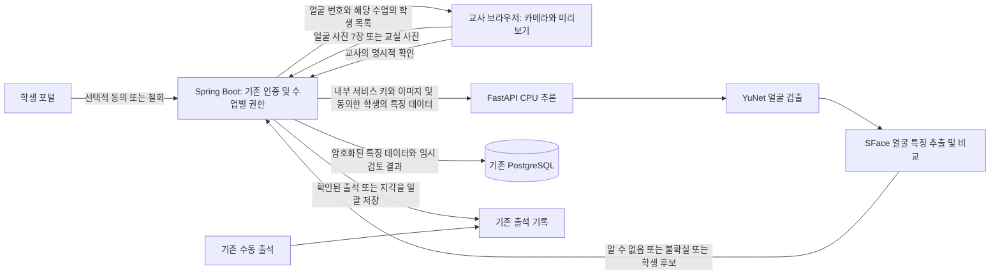

# 1차 구현 가이드: 교사 확인 기반 사진 출석

[English guide](phase1-photo-attendance.md)

현재 상태: 로컬에서 검토할 수 있도록 구현했으며, 기능은 기본적으로 비활성화되어 있습니다. 운영 배포·커밋·푸시는 하지 않았습니다. 작업 브랜치는 `DoJun/phase1-face-attendance`입니다.

## 1. 사용 흐름

1. 기존 절차로 학생 계정을 등록하고 승인합니다. 얼굴 등록은 선택 사항이며, 회원가입이나 계정 승인의 필수 조건이 아닙니다.
2. 승인된 활성 상태의 성인 학생이 학생 포털에서 자발적으로 동의합니다. 데스크톱과 모바일 모두 지원합니다.
3. 담당 교사는 출석 세션을 열고 **Face enrollment and consent status**를 펼친 다음 동의 상태를 새로고침합니다. 학생의 신원을 대면 확인하면서 일곱 가지 자세의 얼굴을 촬영합니다.
4. 교사가 **Open camera**로 카메라를 열고 촬영 동의를 확인한 뒤 **Capture and recognize**를 누릅니다. JPEG 사진 한 장을 즉시 업로드하여 인식하며, 촬영하거나 닫으면 카메라가 꺼집니다. 전면/후면 카메라를 선택할 수 있고 촬영 크기는 최대 1920×1440입니다. 기존 JPEG/PNG 파일도 선택한 뒤 **Recognize faces**로 분석할 수 있습니다. 업로드 실패 시 같은 요청 키로 재시도합니다. 사진에 포함되는 모든 사람은 촬영과 생체정보 처리에 동의해야 합니다. 참여하지 않는 학생은 사진에 포함하지 않고 수동으로 출석을 기록합니다.
5. 화면에 얼굴별 번호와 학생 후보가 표시됩니다. 자동으로 선택되는 학생은 없습니다. 교사가 각 얼굴에 해당하는 학생을 선택하거나 제외하고, 필요한 경우 지각을 표시한 뒤 확인합니다.
6. 교사가 확인한 출석·지각만 저장합니다. 사진에 없는 학생을 자동으로 결석 처리하지 않습니다. 기존 출석 기록을 덮어쓰지 않으며, 수정은 **Correct manually**를 사용합니다.

화면의 주요 버튼은 다음과 같습니다.

| 화면 문구 | 의미 |
| --- | --- |
| Optional photo attendance | 선택적 사진 출석 동의 |
| Give optional consent | 선택적 동의 제출 |
| Withdraw consent and delete face templates | 동의 철회 및 얼굴 특징 데이터 삭제 |
| Face enrollment and consent status | 얼굴 등록 및 동의 상태 |
| Refresh consent status | 동의 상태 새로고침 |
| Enroll face / Replace enrollment | 얼굴 등록 / 기존 등록 교체 |
| Recognize faces | 사진 속 얼굴 인식 |
| Exclude / cannot identify | 제외 / 신원 확인 불가 |
| Confirm and save attendance | 교사 확인 후 출석 저장 |
| Correct manually | 수동 수정 |

## 2. 전체 구조



브라우저는 카메라 촬영, 사진 방향 보정, 크기 조정, EXIF 메타데이터 제거, 교사 검토를 담당합니다. 얼굴 임베딩이나 내부 추론 서비스의 인증 키는 브라우저에 전달하지 않습니다. 여기서 **임베딩 또는 템플릿**은 얼굴의 특징을 수치로 표현한 데이터입니다.

Spring은 동의, 수업별 접근 권한, 데이터 보관 기간, 저장 트랜잭션을 관리합니다. FastAPI는 요청에 따라 추론하고 새 API에서 이미지를 영구 저장하지 않습니다. 추론 서비스에는 학생 이름 대신 학생 UUID와 사용할 수 있는 얼굴 특징 데이터만 전달합니다.

이번 기능은 얼굴을 등록된 학생과 비교하는 기능입니다. 사람의 이동을 추적하는 기능은 포함하지 않습니다. 온라인 수업 관찰, 로봇 카메라 추적, 감정·피로·집중도 추론도 이번 구현 범위에서 제외했습니다.

기존 React, Spring, PostgreSQL, 인증, 출석 서비스를 재사용합니다. Spring 프로세스는 세마포어로 추론 요청을 한 번에 하나만 허용하며, 처리 중인 요청이 있으면 다음 요청에 HTTP 429를 반환합니다. 추론 중에는 데이터베이스 트랜잭션을 유지하지 않습니다. 내부 HTTP 통신은 HTTP/1.1을 사용하고, 연결 제한 시간은 3초, 응답 읽기 제한 시간은 90초입니다.

이 CPU 파일럿에는 작업 큐나 별도의 워크플로 오케스트레이터를 도입하지 않았습니다. 서버를 여러 인스턴스로 늘리려면 인스턴스 간 공통 요청 제어, 큐, 추가 동시성·부하 테스트가 필요합니다.

## 3. 사용 모델과 제한 사항

| 구성 요소 | 구현에 사용한 방식 | 선택 이유 및 한계 |
| --- | --- | --- |
| 얼굴 검출 | OpenCV YuNet 2023mar | CPU에서 실행하는 소형 모델입니다. 어려운 각도, 마스크, 조명, 작은 얼굴에서는 검출에 실패할 수 있습니다. |
| 얼굴 특징 추출 | OpenCV SFace 2021dec, 128차원 | 외부 업체에 요청당 비용을 지불하지 않고 로컬 CPU에서 실행합니다. 실제 대상 학생 집단을 기준으로 보정해야 합니다. |
| 얼굴 비교 | 등록된 템플릿 7개와의 코사인 유사도 중 최댓값 | 기본 임계값 0.50과 1·2순위 차이 기준 0.08은 **보정하지 않은 파일럿 값**입니다. 유사도는 신원 일치 확률이 아닙니다. |
| 사진·영상 위조 탐지(PAD) | 미구현 | 인쇄된 사진이나 영상 재생으로 인식을 속일 수 있습니다. 등록은 교사가 감독하고, 출석도 교사가 확인합니다. |
| 촬영 자세 검증 | 교사의 확인 | 일곱 가지 자세의 촬영 순서를 요구하지만, 실제 얼굴 각도를 자동으로 검증하지는 않습니다. |

고정한 OpenCV Zoo 소스 커밋, 모델 파일명, SHA-256 해시는 `ai-service/models-manifest.json`에 있습니다. 설치 스크립트는 모델 파일의 해시를 검증하고 라이선스 고지문을 함께 저장합니다. 고정한 원본 모델 폴더의 고지에 따르면 YuNet은 MIT, SFace는 Apache-2.0입니다. 이러한 고지가 생체정보 처리의 적법성이나 학습 데이터의 권리를 보장하는 것은 아니며, 기관에서 실제 사용 목적을 별도로 검토해야 합니다.

같은 내부 API 계약을 유지하면서 다른 검출·특징 추출 모델로 교체할 수 있습니다. InsightFace를 선택한다면 소스 코드와 별개로 정확히 어떤 가중치 파일을 사용하는지와 그 라이선스를 확인해야 합니다. 상용 클라우드 얼굴 API는 이용료, 데이터 처리 위치·조건, 새 연동 모듈이 필요합니다. 두 대안은 현재 연동하지 않았습니다. 이번에는 GPU 인프라를 추가하지 않고 로컬에서 시작할 수 있는 YuNet/SFace를 사용했습니다. **얼굴 인식에 GPT 모델은 사용하지 않습니다.**

파일럿의 처리 한계는 다음과 같습니다.

- 수업당 활성 학생 최대 30명, 사진당 검출 얼굴 최대 30개입니다.
- JPEG/PNG만 허용하며, 이미지 해상도는 최대 2,500만 픽셀입니다.
- 서버로 보내는 한 요청의 이미지 데이터 합계는 최대 7 MiB입니다. 얼굴 등록 사진 7장도 합계 기준입니다.
- 브라우저는 원본 사진을 최대 20 MiB까지 받고, 긴 변을 최대 4096픽셀로 줄인 뒤 압축 결과의 크기를 확인합니다.
- 얼굴 검출은 긴 변을 최대 1600픽셀로 줄인 이미지에서 수행합니다.
- 얼굴 크기·밝기·선명도 기준을 통과하지 못하면 학생 후보를 제공하지 않습니다. 알 수 없는 얼굴을 명단의 학생과 억지로 연결하지 않습니다.
- 여러 얼굴에 같은 학생이 후보로 제안되면 불확실한 결과로 처리합니다. 필요하면 소규모 그룹을 가까이서 촬영하거나 수동 출석을 사용합니다.

전체 개발 환경을 함께 실행하는 로컬 평가의 시작 사양으로 논리 코어 4개 이상인 최신 CPU와 시스템 메모리 8 GB 이상을 제안합니다. 이는 검증된 처리 용량을 의미하지 않습니다. OpenCV는 스레드 2개를 사용합니다. 비용은 로컬 컴퓨팅, 저장 공간, 유지보수, 교사 검토 시간이며 외부 추론 API 요금은 추가하지 않았습니다. 실제 지연 시간과 처리 용량은 사용할 장비에서 측정해야 합니다.

## 4. 로컬 실행 준비

현재 노트북에 준비한 Docker 없는 실행 환경을 사용한다면 [Windows 로컬 실행 안내](local-run-windows.ko.md)의 시작·종료 명령을 사용하세요. 아래는 일반적인 설치 절차입니다.

백업한 개발용 데이터베이스를 사용하세요. 이번 변경에는 새 JPA 엔티티와 출석 버전 컬럼이 포함되므로, **`CV_ENABLED=false`여도 변경된 백엔드를 시작하기 전에 마이그레이션을 적용해야 합니다.** 자동으로 적용되는 마이그레이션은 없습니다.

| 데이터베이스 상태 | 적용 방법 |
| --- | --- |
| 기존 개발 DB | 기존 프로젝트의 마이그레이션 절차에 따라 `database/migrations/20261024_add_photo_attendance.sql`을 적용합니다. 파일 번호는 저장소의 기존 마이그레이션 순서를 따릅니다. |
| 새 DB | `database/schema.sql`에 새 구조가 포함되어 있습니다. 기존 DB에 전체 스키마를 다시 적용하여 재생성하지 마세요. |

마이그레이션은 하나의 트랜잭션으로 실행되며, 테스트한 기존 스키마에서 반복 적용을 검증했습니다. 변경되는 구조는 다음과 같습니다.

- `cv_face_profiles`: 동의 상태와 암호화된 얼굴 특징 데이터
- `cv_photo_reviews`: 사진 검토 상태, 암호화된 후보·결정, 검토 메타데이터
- `cv_photo_review_subjects`: 학생의 동의 철회 시 관련 검토 데이터를 찾아 삭제하기 위한 연결 정보
- `attendance_records.version`: 기존 출석이 동시에 변경되는 경우를 확인하기 위한 버전 컬럼

Python 환경을 활성화한 뒤 `ai-service` 디렉터리에서 실행합니다.

```sh
pip install -r requirements-cv.txt
python scripts/install_cv_models.py
```

설치 스크립트는 저장소 루트의 `models/`에 모델 가중치와 라이선스 고지문을 저장합니다. 이 디렉터리는 Git에서 제외되어 있으므로 가중치가 커밋되지는 않습니다. 모델 파일은 로컬 서비스에서 관리하며, 모델을 변경하면 얼굴을 다시 등록해야 합니다.

다음 값을 각 프로세스의 환경 변수로 설정합니다. **Spring과 FastAPI는 루트 `.env`를 자동으로 읽지 않습니다.**

| 환경 변수 | 설정할 프로세스 | 값 |
| --- | --- | --- |
| `CV_ENABLED` | Spring | 로컬 테스트 시 `true`. 기본값은 `false` |
| `CV_SERVICE_URL` | Spring | 같은 컴퓨터에서 실행한다면 `http://127.0.0.1:8000` |
| `CV_SERVICE_KEY` | Spring, FastAPI | 두 프로세스에 동일하게 설정하는 무작위 비밀값. 최소 32자 |
| `CV_ENCRYPTION_KEY` | Spring만 | 암호학적으로 안전하게 생성한 무작위 32바이트를 Base64로 인코딩한 값 |
| `CV_MODEL_DIR` | FastAPI | 모델 디렉터리의 절대 경로. `ai-service`에서 실행한다면 `../models` 사용 가능 |
| `CV_MATCH_THRESHOLD`, `CV_MATCH_MARGIN` | FastAPI | 선택 사항. 기본값은 각각 `0.5`, `0.08` |

서비스 인증 키와 암호화 키는 안전한 생성기로 각각 생성하세요. 테스트 키를 재사용하거나 비밀값을 커밋·로그에 남기거나 `VITE_` 환경 변수로 노출하면 안 됩니다. 암호화 키를 잃으면 기존 템플릿을 읽을 수 없습니다. 키를 바꾸려면 데이터 삭제 후 재등록 또는 별도의 데이터 이전 절차가 필요합니다. 자동 키 교체 기능은 구현하지 않았습니다.

`ai-service`에서 FastAPI를 실행합니다.

```sh
uvicorn app.main:app --host 127.0.0.1 --port 8000 --no-access-log
```

Spring은 기존 `postgres` 프로필과 DB 환경 설정으로 실행하고, Vite는 README의 방법으로 실행합니다. 파일럿에서는 Python 워커 1개와 Spring 인스턴스 1개를 사용합니다. FastAPI는 내부에서만 접근하도록 유지합니다.

모바일 카메라를 사용하려면 HTTPS 또는 해당 기기의 localhost와 같은 브라우저 보안 컨텍스트가 필요합니다. 휴대폰에서 일반 HTTP의 LAN 주소로 접속하는 환경은 지원하는 카메라 실행 환경이 아닙니다. HEIC 사진은 JPEG/PNG로 변환해야 합니다.

상태 API의 `enabled`는 Spring 설정이 준비되었는지를 나타냅니다. Python 서비스나 모델이 정상 동작한다는 상태 검사는 아닙니다. 모델 누락이나 인식 서비스 연결 실패 시 오류를 표시하며 수동 출석을 사용할 수 있습니다. 기존 회원가입, 계정 승인, 수동 출석에는 CV 추론이 필요하지 않습니다.

## 5. 외부 API 계약

아래 경로에는 공통으로 `/api/vision` 접두사가 붙습니다. 기존 `Authorization: Bearer ...` 세션 인증을 사용하고, 응답에 `Cache-Control: no-store`를 설정합니다. URL의 UUID는 데이터베이스 ID이며 화면 표시용 ID가 아닙니다.

| 메서드와 경로 | 권한 | 요청 / 응답 |
| --- | --- | --- |
| `GET /status` | 교사 | `{enabled}` |
| `GET /students/{id}` | 학생 본인 또는 해당 학생 접근 권한이 있는 교사 | `{enabled, consentActive, enrolled, expiresAt, noticeVersion}` |
| `PUT /students/{id}/consent` | 학생 본인만 | JSON `{granted, adultConfirmed, noticeVersion: "adult-pilot-v1"}` → 프로필 |
| `POST /students/{id}/enrollment` | 해당 학생 접근 권한이 있는 교사 | Multipart: `images` 7개, `teacherConfirmed=true` → 프로필 |
| `GET /sessions/{id}/roster` | 해당 세션 접근 권한이 있는 교사 | `{studentId,name,studentNumber,consentActive,enrolled}` 목록 |
| `POST /sessions/{id}/photos` | 해당 세션 접근 권한이 있는 교사 | Multipart: `image`, `captureConsentConfirmed=true`; UUID 형식의 `Idempotency-Key` 헤더 → 검토 결과 |
| `GET /reviews/{id}` | 해당 세션 접근 권한이 있는 교사 | 만료되지 않은 검토 결과 |
| `POST /reviews/{id}/confirm` | 해당 세션 접근 권한이 있는 교사 | 아래 형식의 확인 JSON → 확인 완료된 검토 결과 |

검토 응답 구조는 `{id,state,expiresAt,result:{recognition,roster}}`입니다. `recognition`에는 `modelVersion`, `thresholdVersion`, `faces`가 있습니다. 각 얼굴에는 다음 정보가 포함됩니다.

- `faceId`: 검토 내 얼굴 식별자
- `box`: 0~1 범위로 정규화된 `{x,y,width,height}` 좌표
- `decision`: `MATCH_CANDIDATE`(학생 후보), `UNCERTAIN`(불확실), `UNKNOWN`(알 수 없음), `LOW_QUALITY`(품질 부족)
- `qualityReasons`: 품질 판정 사유
- `candidates`: 최대 3개의 `{studentId,similarity}` 후보

검토의 `roster`에는 사진 처리 시점에 동의와 얼굴 등록이 유효하고 해당 수업에 참여할 수 있는 학생만 포함됩니다.

교사 확인 요청 예시입니다. 아래 ID 자리에는 응답에서 받은 실제 값을 넣습니다.

```json
{
  "teacherConfirmed": true,
  "decisions": [
    {"faceId": "f1", "studentId": "<학생 UUID>", "status": "PRESENT"},
    {"faceId": "f2", "studentId": null, "status": "EXCLUDE"}
  ]
}
```

검출된 모든 얼굴에 정확히 하나의 결정이 필요하며, 같은 학생을 두 번 선택할 수 없습니다. `LATE`도 허용합니다. 서버는 저장 트랜잭션 안에서 동의, 얼굴 등록 버전, 활성 수강 상태, 출석 버전을 다시 확인합니다. 모든 결정을 저장하거나, 오류가 있으면 모두 저장하지 않습니다.

기존 스키마와의 호환을 위해 출석의 `source`는 `AI`로 기록합니다. 승인한 교사와 시각은 검토 기록에 별도로 저장합니다. 체크인 시각은 교사가 확인한 시각이며, 학생의 실제 도착 시각을 측정한 값이 아닙니다.

같은 키와 같은 사진을 순차적으로 재요청하면 기존 검토를 반환합니다. 같은 키를 다른 사진이나 세션에 재사용하면 충돌 처리합니다. 만료 전에 동일한 확인 결정을 반복해 보내도 출석을 중복 저장하지 않으며, 다른 결정으로 재요청하면 충돌 처리합니다. 동시 사진 요청에는 DB 고유 제약이 있지만, 분산 환경에서 재요청을 조정하는 영속적인 처리기는 없습니다. 요청 실패 시 새 키를 만들기 전에 기존 요청을 재시도하세요.

| HTTP 상태 | 대표적인 의미 |
| --- | --- |
| 400 | 잘못된 입력 또는 처리할 수 없는 수업 |
| 401 / 403 | 인증 또는 접근 권한 문제 |
| 409 | 동의·명단·출석 변경, 이미 확인한 결정과의 충돌 |
| 410 | 만료된 검토 |
| 413 | 이미지 크기 제한 초과 |
| 422 | 얼굴 또는 이미지 품질 검사 실패 |
| 429 | CPU 인식 서비스가 다른 요청을 처리 중 |
| 502 | 형식이 올바르지 않은 추론 응답 |
| 503 | 인식 기능 비활성화 또는 서비스 사용 불가 |

추론 실패로 출석이 저장되는 일은 없습니다.

### 내부 FastAPI 계약

두 API 모두 `X-CV-Service-Key`가 필요하며 브라우저에 직접 노출하지 않습니다.

| API | 요청 | 응답 |
| --- | --- | --- |
| `POST /v2/face/enroll` | Multipart `images` 7개와 순서가 지정된 JSON `poses` 폼 필드 | `modelVersion`, 정규화된 `templates` 7개, `qualityPassed`, `padStatus`, `poseStatus` |
| `POST /v2/face/recognize` | Multipart `image`와 학생 UUID·모델 버전·템플릿을 담은 JSON `subjects` | 위에서 설명한 `recognition` 구조 |

## 6. 데이터 보관, 보안, 운영 전 확인 사항

| 데이터 | 처리 방법 |
| --- | --- |
| 새 얼굴 등록 사진·교실 사진 | 이 기능에서는 메모리에서만 처리합니다. 브라우저 미리보기는 저장·폐기·검토 만료·화면 해제 시 해제합니다. 사용자의 카메라나 갤러리에는 원본이 남을 수 있습니다. |
| 얼굴 특징 데이터 | 무작위 nonce와 학생별 인증 문맥을 사용하는 AES-256-GCM 암호화. 동의 시점부터 30일간 유효합니다. |
| 후보 목록·교사 결정 | 검토별 인증 문맥으로 암호화하며, 30분이 지나면 접근할 수 없습니다. |
| 동의 철회 | 애플리케이션 DB의 템플릿과 관련 검토 데이터를 즉시 지우고 대기 중인 확인을 무효화합니다. |
| 만료 데이터 정리 | Spring 실행 중 1분마다 수행합니다. 서버 중단 중 만료된 데이터는 재실행 후 정리 작업에서 지웁니다. |
| 검토 메타데이터 | 검토·세션·교사·요청 ID와 시각을 최대 90일 보관 후 삭제합니다. 학생별 삭제 연결 정보는 검토 데이터 삭제와 함께 지웁니다. |
| 동의 메타데이터 | 동의·철회 시각과 고지 버전은 학생 기록에 남습니다. 이 최소 기록의 별도 만료 기간은 구현하지 않았습니다. |
| 출석 기록 | 기존 학적 기록 보관 정책을 따릅니다. 동의를 철회해도 이미 확인된 출석은 삭제하지 않습니다. |

Python은 multipart 파싱 전에 요청 크기를 제한하고, Spring도 업로드 제한 범위 안에서 이미지를 메모리로 처리합니다. TLS·내부 네트워크 구성, 요청 본문 로깅 금지, DB·백업 접근 제한, 비밀값 관리, 백업에서의 만료 데이터 삭제는 배포 환경에서 관리해야 합니다.

현재 구현은 백업 사본이나 기존 회원가입 기능이 저장했던 과거 얼굴 사진을 삭제하지 않습니다. 기존 사진을 새 얼굴 템플릿으로 자동 변환하거나 가져오지도 않습니다.

실제 참여자를 대상으로 사용하기 전에 기관에서 목적, 적용 관할, 고지문, 적법한 처리 근거, 불이익 없는 자발적 참여, 보관·백업, 열람·정정 절차, 연구 윤리 요건을 검토하고 승인해야 합니다. 성인 체크박스는 본인의 진술이며 나이 검증이나 법적 허용의 증거가 아닙니다. 미성년자는 이번 파일럿 범위에 포함하지 않습니다. 법적 적합성이나 운영 준비가 완료되었다고 주장하는 구현은 아닙니다. 감정·피로·집중도 모델은 추가하지 않았습니다.

## 7. 검증 및 수용 기준

구현에서 확인하는 기능 기준은 다음과 같습니다.

- 사진 출석 저장에는 교사의 검토가 반드시 필요합니다. 제외하거나 사진에 없는 학생의 출석은 변경하지 않습니다.
- 접근 권한이 없는 교사, 다른 학생으로의 사칭 요청, 철회·만료된 동의, 변경된 수강 상태로는 출석을 저장할 수 없습니다.
- 중복 학생 선택, 누락된 얼굴 결정, 기존 수동 출석 덮어쓰기, 충돌하는 재요청은 전체 저장을 거부합니다.
- 템플릿은 암호화되며, 만료·동의 철회 시 암호화 키 없이도 관련 데이터를 삭제할 수 있습니다.
- 얼굴 등록 없이 회원가입과 계정 승인이 가능합니다.
- 데스크톱·모바일 너비에서 재촬영, 명시적 제외, 저장 후 출석 표 갱신을 지원합니다.

CV 의존성과 모델을 설치한 뒤 다음 명령으로 테스트합니다. 아래 명령은 `sh` 계열 셸 기준이며, PowerShell에서는 각 `cd`와 명령을 줄별로 실행해도 됩니다.

```sh
cd backend && mvn test
cd ../frontend && npm test && npm run build
cd ../ai-service && python -m unittest discover -s tests -v
```

`VisionServiceTest`는 기본적으로 H2를 사용합니다. 실제 PostgreSQL 검증에는 폐기 가능한 테스트 DB를 만들고 스키마·마이그레이션을 적용한 뒤 `CV_TEST_DATABASE_URL`을 설정합니다. 필요한 경우 `CV_TEST_DATABASE_USER`(기본값 `cv_test`)와 `CV_TEST_DATABASE_PASSWORD`도 설정합니다. 합성 레코드를 만드는 테스트이므로 공유·운영 DB를 지정하지 마세요.

Java에서 실제 Python으로 요청을 보내는 검증에는 `CV_TEST_SERVICE_URL`과 Python에 설정한 것과 같은 `CV_SERVICE_KEY`를 설정한 뒤 `VisionGatewayTest`를 실행합니다. CI는 기존 품질 검사 전에 CV 의존성과 해시가 검증된 모델을 설치하도록 구성되어 있습니다.

2026-10-16 로컬 검증 결과는 다음과 같습니다. 자세한 근거와 한계는 [검토 체크포인트](phase1-work-in-progress.md)에 기록했습니다.

| 검증 항목 | 결과 |
| --- | --- |
| 전체 Java 테스트 | 353개 통과, 실패·오류·건너뛴 테스트 없음 |
| Python 테스트 | 49개 통과 |
| 프런트엔드 모델 테스트 | 142개 통과 |
| TypeScript 검사 및 Vite 빌드 | 통과 |
| 프런트엔드 모듈 경계 검사 | 통과 |
| PostgreSQL 16.15 | 스키마와 마이그레이션 반복 적용, Hibernate 검증, VisionService 통합 테스트 17개 통과 |
| 실제 Java↔Python 통신 | Multipart 요청과 얼굴 없는 이미지 처리 검증 통과 |
| 브라우저 | Chrome의 1440×1000 및 390×844 화면에서 등록·재촬영·검토·제외·저장·출석 표 갱신·철회 확인 |

**이 결과는 실제 학생 얼굴의 인식 정확도를 입증하지 않습니다.** 신원 일치 성공 경로는 실제 참여자의 사진 대신 합성 임베딩과 모의 추론으로 검증했습니다. 실제 YuNet/SFace 검증은 고정 모델 로딩, 생성한 빈 이미지에서 얼굴을 찾지 않는지, 얼굴 없는 등록을 거부하는지를 확인했습니다.

브라우저 검증은 실제 컴포넌트에 모의 HTTP 응답과 합성 카메라를 사용했습니다. 로그인부터 DB 저장까지 모든 실제 서비스를 연결한 완전한 종단 간 테스트는 아닙니다. 원격으로 푸시하지 않았으므로 수정한 GitHub 워크플로의 원격 실행 결과도 아직 없습니다.

### 실제 참여자 파일럿 전에 필요한 평가

별도로 동의받은 데이터로 평가하고, 등록 사진과 시험 사진은 서로 다른 촬영 세션에서 수집해야 합니다. 잘못된 일치, 올바른 학생의 불일치, 미등록자 오인식, 등록 실패, 얼굴 검출 재현율, 교사 수정 비율을 측정합니다. 표본 수와 신뢰구간을 함께 보고하고, 조명·거리·자세·가림·다중 인물·관련 집단별 결과도 확인합니다.

| 지표 | 제안하는 검토 기준 |
| --- | --- |
| 잘못된 일치 비율 | 0.1% 이하 |
| 미등록자를 등록 학생으로 잘못 식별한 비율 | 0.1% 이하 |
| 품질 기준을 충족한 사진에서 올바른 학생을 일치시키지 못한 비율 | 5% 이하 |
| 품질 기준 미달 입력 | 자동 신원 결정 없음 |
| 모델 준비 후 추론 지연 시간 | 최대 30개 얼굴 사진 1장에 대해 p95 10초 이하를 목표로 제안 |

이 수치는 **이미 달성한 성능이 아니라 제안한 목표**입니다. 평가 전에 기관과 표본 수·임계값을 정해야 합니다. p95는 측정한 요청의 95%가 해당 시간 이내에 완료된다는 뜻입니다. 모델 최초 로딩을 포함한 시간과 준비 후 시간을 나누어 실제 CPU에서 측정하세요.

추가로 429 응답, 메모리 사용 제한, 시간 초과 복구, 동의 철회, 수동 수정과의 동시 실행, 서버 재시작 후 정리를 검증해야 합니다. 인쇄 사진·영상 재생 공격으로 PAD가 없다는 한계도 확인하고, 이 기능을 안전한 신원 인증 수단이라고 제시하면 안 됩니다. 실제 휴대폰·브라우저의 카메라 호환성과 완전한 인증 포함 종단 간 테스트도 운영 전 검증 항목으로 남아 있습니다.

## 8. 변경 파일 안내

아래 경로는 저장소 루트를 기준으로 합니다. 긴 Java 패키지 경로의 `...`는 기존 패키지 경로를 생략한 표시입니다.

| 영역 | 주요 파일 |
| --- | --- |
| 추론·모델 설치 | `ai-service/app/services/vision.py`, `ai-service/app/api/vision.py`, `ai-service/app/api/vision_boundary.py`, `ai-service/app/main.py`, `ai-service/requirements-cv.txt`, `ai-service/models-manifest.json`, `ai-service/scripts/install_cv_models.py` |
| 권한·동의·암호화·검토 저장 | `backend/.../vision/`, `AttendanceRecord.java` |
| 얼굴 등록 없는 회원가입 | 인증·직원용 컨트롤러, 요청 DTO, 등록 서비스, `StudentService.java`; `AuthPage.tsx`, `RegisterForm.tsx`, `AddStudentModal.tsx` |
| 화면 | `frontend/src/features/photo-attendance/`, `SessionDetail.tsx`, `StudentPortal.tsx`, `MobileStudentPortal.tsx` |
| DB·설정 | CV 마이그레이션, `database/schema.sql`, Spring 설정 YAML, `.env.example` |
| 테스트·CI | Java `vision/` 테스트, `ai-service/tests/test_vision.py`, `frontend/tests/photoAttendance.test.cjs`, 프런트엔드 테스트 스크립트, 품질 검사 워크플로 |

변경 내용을 로컬에서 검토한 뒤 커밋하세요. `CV_ENABLED`를 끄면 얼굴 등록·추론 접근은 비활성화되지만 동의 철회와 만료 데이터 정리는 유지됩니다. 이 백엔드 버전을 실행하려면 기능 비활성화 여부와 관계없이 추가된 DB 구조가 필요합니다. 운영 배포나 원격 브랜치 업데이트는 포함하지 않았습니다.
