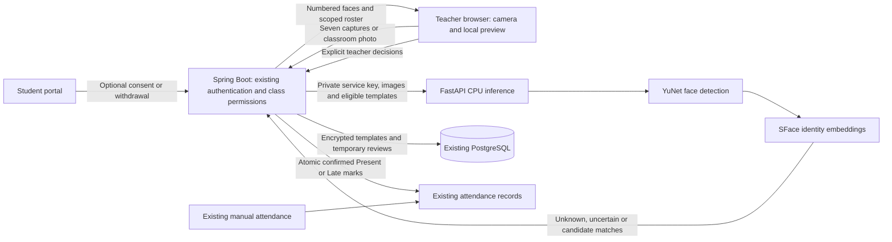

# Phase 1: supervised photo attendance

[한국어 구현 가이드](phase1-photo-attendance.ko.md)

Status: implemented for local review; disabled by default. No production deployment, commit or push was performed. Work branch: `DoJun/phase1-face-attendance`.

## User workflow

1. Register and approve a student through the existing workflow. Face capture is optional and no longer blocks registration or approval.
2. An approved, active adult volunteer gives optional consent in their student portal (desktop or mobile).
3. The assigned teacher opens an attendance session, expands **Face enrollment and consent status**, refreshes consent, and captures seven poses while checking the student's identity in person.
4. The teacher selects **Open camera**, checks capture consent, then selects **Capture and recognize**. One JPEG frame is uploaded immediately; the camera stops on capture or close. Front/rear camera preference is available, with a 1920×1440 capture limit. Existing JPEG/PNG files can still be selected and submitted with **Recognize faces**. Failed uploads can be retried with the same request key. Everyone in the frame must have agreed to capture and biometric processing. Non-participants use manual attendance and stay out of the frame.
5. The app displays numbered faces and possible identities. Nothing is preselected. The teacher explicitly assigns an eligible student or excludes each face, optionally marks late, and confirms the decisions.
6. Only confirmed Present/Late marks are saved. Missing faces never imply absence. Existing attendance is protected from overwriting; use **Correct manually** for corrections.

## Architecture



The browser handles camera capture, orientation normalization, resizing, EXIF removal and review. It receives neither embeddings nor inference credentials. Spring owns consent, class authorization, retention and transactions. FastAPI performs stateless inference; the new routes do not persist images. Names are not sent to inference, only student UUIDs and eligible templates. This feature performs identity matching, not person tracking. Online observation, robot tracking, emotion, fatigue and attention inference are outside this implementation.

Existing React, Spring, PostgreSQL, authentication and attendance services are reused. A single-process semaphore admits one Spring inference request at a time; a second request returns 429. Inference runs outside database transactions. The private HTTP client uses HTTP/1.1, a 3-second connection timeout and a 90-second read timeout. There is no job queue or workflow orchestrator in this CPU pilot. Multiple replicas would require shared admission control, queueing and additional concurrency/load tests.

## Models and limits

| Component | Implemented choice | Reason and limitation |
| --- | --- | --- |
| Face detector | OpenCV YuNet 2023mar | Small CPU model; difficult poses, masks, lighting and small faces can fail |
| Identity embedding | OpenCV SFace 2021dec, 128 dimensions | Local CPU inference without per-request vendor charges; must be calibrated on the intended cohort |
| Matching | Maximum cosine similarity across seven templates | Default threshold 0.50 and runner-up margin 0.08 are explicitly **uncalibrated pilot values**, not probability estimates |
| Presentation attack detection | Not implemented | A printed photo or replay may fool matching. Enrollment is teacher supervised; all attendance requires human review |
| Pose verification | Teacher confirmation | Seven ordered capture prompts are enforced; pose angles are not automatically verified |

The pinned OpenCV Zoo source commit, filenames and SHA-256 hashes are in `ai-service/models-manifest.json`. The installer verifies weights and saves accompanying notices: YuNet MIT and SFace Apache-2.0 according to the pinned upstream model folders. These notices do not establish lawful use of biometric data or guarantee training-data rights. Institutional review must assess the intended use separately.

Alternative detectors/embeddings can replace the private service behind this contract. An InsightFace package requires checking the license of the exact weights separately from its source code. A commercial hosted face API adds vendor fees, data processing/region decisions and a new provider adapter. Neither alternative is integrated here. YuNet/SFace provides a practical local baseline without adding GPU infrastructure. No GPT model is used for face recognition.

Pilot limits: at most 30 active students per class and 30 detected faces; JPEG/PNG only; at most 25 megapixels; total image bytes per request at most 7 MiB. The browser accepts source photos up to 20 MiB, then resizes to a longest side of 4096 and checks the compressed size. Detection runs at a longest side of 1600. Faces below the size, brightness or sharpness gates receive no candidates; unknown identities are not forced into the roster. Duplicate proposed identities become uncertain. Use closer subgroup photos or manual attendance when needed.

Start local evaluation on a modern CPU with at least four logical cores and 8 GB system RAM for the complete development stack; this is a starting configuration, not a measured capacity claim. OpenCV uses two threads. Costs are local compute, storage, maintenance and human review; no inference API fee is introduced. Latency and capacity remain to be benchmarked on the target device.

## Local setup

The integrated upstream backend uses Flyway. Fresh databases are created by versioned migrations, including `V3__photo_attendance.sql`, even when CV is disabled. Existing unversioned databases require the reviewed legacy alignment/adoption procedure in `docs/production-readiness.md` before application startup; do not simply enable automatic baselining or recreate a database containing user data.

The historical `database/migrations/20261024_add_photo_attendance.sql` remains available for the legacy upgrade sequence. V3 is additive and also accepts databases where that historical CV migration was already applied. It creates `cv_face_profiles`, `cv_photo_reviews`, `cv_photo_review_subjects`, and `attendance_records.version`. Do not modify the existing V1/V2 migration checksums.

From `ai-service`, with the Python environment activated:

```sh
python -m pip install --only-binary=:all: --require-hashes -r requirements.lock
python -m pip install --only-binary=:all: --require-hashes --no-deps -r requirements-cv.lock
python scripts/install_cv_models.py
```

The installer puts weights and license notices in the ignored root `models/` directory. Git does not carry the weights. Keep them private to the local service; model changes require re-enrollment.

Configure process environment variables (Spring and FastAPI do not automatically load the root `.env`):

| Variable | Process | Value |
| --- | --- | --- |
| `CV_ENABLED` | Spring | `true` to enable local testing; defaults to `false` |
| `CV_SERVICE_URL` | Spring | `http://127.0.0.1:8000` for same-host development |
| `CV_SERVICE_KEY` | Spring and FastAPI | Same randomly generated secret, at least 32 characters |
| `CV_ENCRYPTION_KEY` | Spring only | Base64 encoding of 32 cryptographically random bytes |
| `CV_MODEL_DIR` | FastAPI | Absolute model directory, or `../models` when started from `ai-service` |
| `CV_MATCH_THRESHOLD`, `CV_MATCH_MARGIN` | FastAPI | Optional; defaults `0.5`, `0.08` |

Generate separate service/encryption secrets with a secure generator. Never reuse test keys, commit secrets, log them, or expose them via `VITE_` variables. Losing the encryption key makes existing templates unreadable; changing it requires a deliberate erase/re-enrollment or migration procedure. Automated key rotation is not implemented.

Run `uvicorn app.main:app --host 127.0.0.1 --port 8000 --no-access-log` from `ai-service`. Start Spring using the existing `postgres` profile and database environment, then start Vite as documented in README. Run one Python worker and one Spring instance for this pilot. Keep FastAPI private. Mobile camera access requires a browser secure context (HTTPS, or localhost on the same device); a phone visiting a plain HTTP LAN address is not a supported camera setup. HEIC photos must be exported as JPEG/PNG.

The status endpoint reports Spring configuration readiness, not Python/model health. Missing models or an unreachable recognizer produce a recoverable error with manual attendance available. Existing accounts, approvals and manual attendance do not require CV inference.

## Public API contract

All `/api/vision` routes use the upstream HttpOnly session cookie; mutating requests require CSRF proof through the shared API client. Public Bearer headers are not accepted. Responses have `Cache-Control: no-store`. UUID parameters are database IDs, not UI display IDs.

| Method and path | Access | Input / result |
| --- | --- | --- |
| `GET /status` | Teacher | `{enabled}` |
| `GET /students/{id}` | Student self or scoped teacher | `{enabled, consentActive, enrolled, expiresAt, noticeVersion}` |
| `PUT /students/{id}/consent` | Student self only | JSON `{granted, adultConfirmed, noticeVersion: "adult-pilot-v1"}`; returns profile |
| `POST /students/{id}/enrollment` | Scoped teacher | Multipart: seven `images`, `teacherConfirmed=true`; returns profile |
| `GET /sessions/{id}/roster` | Scoped teacher | List of `{studentId,name,studentNumber,consentActive,enrolled}` |
| `POST /sessions/{id}/photos` | Scoped teacher | Multipart `image`, `captureConsentConfirmed=true`; UUID `Idempotency-Key` header; returns review |
| `GET /reviews/{id}` | Teacher authorized for its session | Returns unexpired review |
| `POST /reviews/{id}/confirm` | Teacher authorized for its session | JSON confirmation below; returns reviewed result |

A review contains `{id,state,expiresAt,result:{recognition,roster}}`. Recognition contains `modelVersion`, `thresholdVersion`, and `faces`. Each face has `faceId`, normalized `{x,y,width,height}` box, `decision`, `qualityReasons` and up to three `{studentId,similarity}` candidates. Decisions are `MATCH_CANDIDATE`, `UNCERTAIN`, `UNKNOWN` or `LOW_QUALITY`. The review roster contains only consenting, enrolled students eligible at capture time.

Example confirmation (replace placeholder IDs with response values):

```json
{
  "teacherConfirmed": true,
  "decisions": [
    {"faceId": "f1", "studentId": "<student UUID>", "status": "PRESENT"},
    {"faceId": "f2", "studentId": null, "status": "EXCLUDE"}
  ]
}
```

Every detected face needs exactly one decision, and each student may be chosen only once. `LATE` is also allowed. The server rechecks consent, enrollment revision, active membership and attendance version inside a transaction. Confirmation writes all decisions or none. Attendance source is `AI` for existing schema compatibility; the review separately records the approving teacher and timestamp. Check-in time is confirmation time, not a claimed arrival time.

Sequential same-key/same-photo retries return the existing review; reuse for another photo/session conflicts. Repeating the identical confirmed decisions before expiry is idempotent; different decisions conflict. Concurrent photo creation has a unique database constraint but no durable distributed replay coordinator. Retry after a failed request before generating a new key.

Expected failures: 400 invalid inputs or ineligible class, 401/403 existing authentication/authorization failure, 409 changed consent/roster/attendance or conflicting review, 410 expired review, 413 oversized images, 422 rejected face/image quality, 429 busy CPU service, 502 invalid inference response, 503 unavailable or disabled inference. No inference failure writes attendance.

Private FastAPI contracts: `POST /v2/face/enroll` takes seven `images` and the ordered JSON `poses` form field; returns `modelVersion`, seven normalized `templates`, `qualityPassed`, `padStatus` and `poseStatus`. `POST /v2/face/recognize` takes `image` plus JSON `subjects` containing student UUIDs, model version and templates; returns recognition above. Both require `X-CV-Service-Key`. Do not expose them directly to browsers.

## Data, security and rollout gates

| Data | Handling |
| --- | --- |
| New enrollment and classroom images | Memory only in this feature; browser preview released on save/discard/expiry/unmount. The user's camera/gallery may retain its own original |
| Face templates | AES-256-GCM with random nonce and student-specific authenticated context; valid for 30 days from consent |
| Candidate lists and decisions | Encrypted with review-specific authenticated context; inaccessible after 30 minutes |
| Withdrawal | Immediately erases stored templates and dependent review payloads in the application database; invalidates pending confirmations |
| Cleanup | Scheduled every minute while Spring is running; clears expired data on the next run after downtime |
| Review metadata | Review/session/teacher/request identifiers and timestamps retained up to 90 days, then purged; subject deletion index cleared with payload |
| Consent metadata | Consent/revocation timestamps and notice version remain with the student record; no separate expiry for this minimal record is implemented |
| Attendance | Existing academic-record retention rules apply; withdrawal does not delete confirmed attendance |

Raw images are bounded before Python multipart parsing and held in memory under the Spring upload limits. TLS/private networking, no request-body logging, restricted DB/backup access, secret management and deletion of expired data from backup cycles are deployment responsibilities. This implementation does not delete backup copies or erase historical photos created by the legacy registration feature. Existing legacy face images are not automatically imported into the new templates.

Before involving participants, the institution must approve the purpose, applicable jurisdiction, notices, lawful basis, voluntary participation without disadvantage, retention/backups, access/correction procedures and any ethics requirements. An adult checkbox is a self-attestation, not verified age or proof of legal permission. Minors are outside this pilot. No claim of legal compliance or operational readiness is made. No emotion, fatigue or attention model has been added.

## Validation and acceptance

Implemented functional gates:

- Teacher review is required for every attendance write; excluded/unseen students remain unchanged.
- Unauthorized teachers, student impersonation, withdrawn/expired consent and changed membership cannot save attendance.
- Duplicate identities, incomplete decisions, overwritten manual marks and conflicting replay decisions are rejected atomically.
- Templates are encrypted; expiry and withdrawal erase dependent payloads without needing the encryption key.
- Registration and approval work without facial enrollment.
- Browser review works at desktop and mobile widths, including camera retake, explicit exclusion and attendance table refresh.

Reproducible checks after installing CV dependencies/models:

```sh
cd backend && mvn test
cd ../frontend && npm test && npm run build
cd ../ai-service && python -m unittest discover -s tests -v
```

`VisionServiceTest` normally uses H2. To validate real PostgreSQL, first apply the schema/migration to a disposable database, then set `CV_TEST_DATABASE_URL`, optional `CV_TEST_DATABASE_USER` (default `cv_test`) and `CV_TEST_DATABASE_PASSWORD`. This test creates synthetic records; never point it at shared/production data. To exercise Java against actual Python, set `CV_TEST_SERVICE_URL` and the matching `CV_SERVICE_KEY` before running `VisionGatewayTest`. CI installs CV dependencies and checksum-verified models before the existing quality gate.

Local evidence and limits are recorded in `phase1-work-in-progress.md`. Positive identity paths use synthetic embeddings/mock inference, not participant photographs. Real YuNet/SFace checks load the pinned models, detect no faces in a generated blank image and reject faceless enrollment. Browser QA uses actual components with mocked HTTP and a synthetic camera; it is not a full authenticated browser-to-database end-to-end test.

Before enabling a participant pilot, run a separately consented evaluation with enrollment/test images separated by capture session. Report false match, false non-match, unknown-person false identification, failure-to-enroll, face detection recall and teacher correction rates, with sample counts/confidence intervals and lighting, distance, pose, occlusion, multi-person and relevant cohort breakdowns. Proposed review gates: false match and unknown-person false identification each at most 0.1%, false non-match at most 5% on acceptable-quality captures, and no automatic decisions for rejected-quality input. These are targets, not achieved results; agree sample size and thresholds with the institution before evaluation.

Benchmark warm and cold inference separately on the target CPU. Proposed warm p95 target: at most 10 seconds for one classroom photo with up to 30 faces. Verify the 429 busy response, bounded memory, timeout recovery, rapid consent withdrawal, concurrent manual corrections and restart cleanup. Test printed-photo/video replays to document the lack of PAD; do not present the feature as secure identity authentication. Real phone/browser camera compatibility and a complete authenticated end-to-end test remain rollout gates.

## File map

| Area | Files |
| --- | --- |
| Inference and model supply | `ai-service/app/services/vision.py`, `app/api/vision.py`, `app/api/vision_boundary.py`, `app/main.py`, `requirements-cv.txt`, `models-manifest.json`, `scripts/install_cv_models.py` |
| Authorization, consent, crypto, review transactions | `backend/.../vision/` and `AttendanceRecord.java` |
| Registration without biometrics | Auth/staff controllers, request DTOs, registration services and `StudentService.java`; `AuthPage.tsx`, `RegisterForm.tsx`, `AddStudentModal.tsx` |
| UI | `frontend/src/features/photo-attendance/`, `SessionDetail.tsx`, `StudentPortal.tsx`, `MobileStudentPortal.tsx` |
| Database/configuration | CV migration, `database/schema.sql`, Spring application YAML, `.env.example` |
| Tests/CI | Java `vision/` tests, `ai-service/tests/test_vision.py`, `frontend/tests/photoAttendance.test.cjs`, frontend test script and quality workflow |

Review these changes locally before committing. Disabling `CV_ENABLED` removes enrollment/inference access but allows consent withdrawal and cleanup; additive database changes remain necessary for this backend version. No production rollout or remote branch update is included.

## Upstream integration verification (2026-10-21)

Integrated upstream main `3dc80b5` into phase1 `895591c` without committing or pushing. Nine textual conflicts were resolved while preserving optional biometric registration and the upstream staff activation/existing-account email proof, cookie/CSRF, assistant, reporting and payment changes. CV now uses Jackson 3 and Boot 4 test APIs; its private Python boundary retains its own service key and 9 MiB limit alongside the legacy adapter boundary. Flyway V3 adds the CV tables without rewriting V1/V2. Phase2 is unchanged and must be integrated separately after the user commits this merge.

| Validation | Result |
| --- | --- |
| Full backend suite | 564 tests: 559 passed, 5 conditional tests skipped in the general run |
| Conditional PostgreSQL tests | All 4 ran successfully on each of two isolated databases: fresh and historical upgrade; migration repeatability, ORM mappings, session restart and staff authorization |
| Conditional live Python gateway test | Executed separately on loopback port 8002 with real pinned models and synthetic faceless images; all 3 gateway tests passed, none skipped |
| Frontend | 333 tests and module boundaries passed; TypeScript/Vite build passed |
| Python | 65 tests passed, including real-model no-face smoke and independent CV authorization |
| Browser | Actual phase1 components with mocked API and synthetic camera at 1440×1000 and 390×844; consent, 7 captures, retry, candidate selection, review/save, manual fallback and camera cleanup passed |
| Dependency checks | Vite 6.4.4: npm audit zero findings; Java/Python audit: 144 coordinates, zero findings at check time |

Pillow was updated to 13.0.0 and certifi to 2026.10.19 after advisory checks. CV wheels are now hash-pinned in `requirements-cv.lock`. The shared lock excludes Linux-only uvloop on Windows. Browser automation uses Playwright because the Browser plugin is unavailable. It does not establish actual identity accuracy or phone hardware compatibility.

The upstream migration-tool Python suite ran 18 tests on Windows: 11 passed and 7 errored because of POSIX directory APIs/symlink privileges. Those tools were not weakened to make the Windows run pass; the Linux CI quality gate remains required. The aggregate shell quality gate and deployment readiness are not claimed as passed.

No user database, face record, attendance record, remote branch, or phase2 commit was changed. Test databases used port 55439; the user's database on 55440 was not migrated. The old frontend dev server was stopped to unlock esbuild for dependency installation. Before running this integrated backend against an existing local database, review backup/alignment/Flyway adoption as described above. Do not switch branches during the pending merge or run the old setup script to recreate the database.

Evidence: ignored `data/phase1-main-merge-*.log`, `data/phase1-merge-audit.json`, `data/phase1-merge-live-gateway.log`; external visualization directory contains `phase1-merge-ui-qa.mjs` and `phase1-merge-camera-*` screenshots/results. Final targeted runs replace their matching Surefire XML reports.
