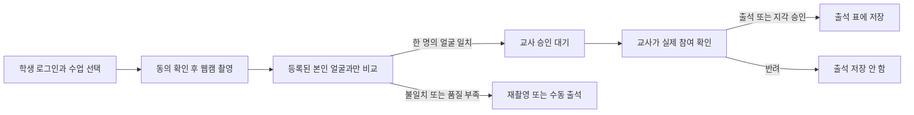

# 2A 구현·테스트 가이드: 학생 촬영 후 교사 승인

[English guide](phase2a-student-checkin.md)

브랜치: `DoJun/phase2-student-attendance`. 1차 커밋 `895591c`에서 분기했습니다. 에이전트는 커밋·푸시·PR 생성·운영 배포를 하지 않습니다.

## 이번에 추가한 기능

### 가입 시 선택적 얼굴 등록과 관리자 승인 (2026-10-20)

가입 화면에서 **Manual attendance**(기본값, 사진 불필요) 또는 **Face attendance**를 선택합니다. 두 방식 모두 관리자 승인 전에는 `PENDING` 상태입니다. 얼굴 출석은 기존 성인 자원자 파일럿 범위에서만 제공하며, 동의 후 웹캠으로 7장을 촬영합니다. 서버의 실제 YuNet/SFace 모델이 사진 품질·사진당 한 명의 얼굴·동일인 일관성을 검사합니다. 실패하면 가입이나 수강 신청을 만들지 않으므로 다시 촬영하거나 수동 출석을 선택합니다. 촬영 자세나 실제 생체 여부를 자동으로 검증하는 기능은 아닙니다.

**테스트 순서**

1. 로그아웃하고 **Create account**를 누릅니다. 기존 계정과 다른 학번·이메일로 입력하고 열린 수업을 선택합니다.
2. 사진 없이 가입하려면 **Manual attendance → Submit for admin approval**을 누릅니다. 카메라는 켜지지 않습니다.
3. 얼굴 출석을 원하면 **Face attendance → Continue to webcam captures**를 누릅니다. 안내문을 읽고 성인·자발적 동의를 체크하면 카메라가 켜집니다.
4. 정면부터 안내에 따라 **Capture pose**를 7번 누릅니다. 모두 촬영하면 카메라가 종료됩니다. **Submit for review**로 제출합니다. 실패하면 **Retake all**로 다시 촬영할 수 있습니다.
5. `Registration submitted` 화면은 가입 신청이 접수되었지만 아직 관리자 승인이 필요하다는 뜻입니다.
6. **admin 계정**으로 로그인 → **Registrations → Review**를 엽니다. 학번·이메일·수강 신청을 실제 명단과 확인하고 얼굴 출석 신청이면 7장도 검토합니다. 본인 확인 체크 후 **Approve registration**을 누릅니다. 일반 teacher 계정은 가입을 승인할 수 없습니다.
7. 학생으로 다시 로그인하거나 **Refresh approval status**를 누르면 승인된 계정으로 이용합니다. 얼굴 등록 승인까지 된 학생은 추가 교사 얼굴 등록 없이 사진 출석을 요청할 수 있습니다. 수동 출석을 선택한 학생은 교사가 수동 출석을 기록합니다.

가입 승인 자체로 출석이 저장되지는 않습니다. **관리자의 가입 승인**과 **교사의 출석 요청 승인**은 별개입니다.

승인 대기 사진과 얼굴 정보는 새 `cv_registration_faces` 테이블에 암호화해 최대 7일 보관하고, 승인·거절·수동 전환 시 삭제합니다. 만료 시 1분 주기 정리 작업이 삭제하며, 만료된 사진으로 얼굴 등록을 승인할 수 없습니다. 학생은 승인 대기 화면의 **Remove photos and use manual attendance**로 사진을 삭제하고 수동 출석으로 전환할 수 있습니다. 이때 관리자도 목록을 새로고침합니다. 승인 후 인식용 정보는 최초 동의 제출부터 30일 만료이며 기존 동의 철회 기능을 사용할 수 있습니다.

최신 main 통합본에서는 저장소의 Flyway 명령으로 V4(학생 출석 요청)·V5(가입 얼굴 검토)를 적용한 후 백엔드를 실행합니다. Flyway 관리 DB에 과거 개별 SQL을 별도로 적용하지 마세요. CV 비활성화 상태여도 테이블은 필요합니다. 기존 얼굴·출석 데이터는 변경하지 않습니다. 이전 가입 API는 호환성을 위해 남아 있지만 새 가입 화면은 실제 출석용 CV 서비스를 사용합니다. 예전 가입용 사진을 자동으로 출석용 얼굴 정보로 전환하지는 않습니다.

학생이 포털에서 자신의 수업을 선택해 사진을 찍으면 **로그인한 학생의 등록 얼굴과만 비교**합니다. 한 명의 얼굴이 일치한 경우 교사 승인 대기 요청을 만들고, 교사가 실제 참여 여부를 별도로 확인한 뒤 출석 또는 지각을 승인합니다. 반려하면 출석은 저장하지 않습니다.

기존 교사의 단체 사진 인식·수동 출석·얼굴 등록 기능도 유지합니다. 생체 감지(PAD), 자동 출석 확정, 수업 내내 영상 분석, 감정·피로·집중도 추론, 로봇 기능은 추가하지 않았습니다. 웹캠 촬영만으로 실제 사람이 현장에 있음을 증명할 수는 없습니다.

## 최신 main 통합 사항 (2026-10-22)

현재 브랜치는 최신 phase1(`42efcb4`)의 쿠키·CSRF 인증, Flyway, 실제 UTC 수업 시간을 유지합니다. 기존에 생성된 비밀번호 없는 학생 계정을 활성화하려면 이메일/로컬 관리자 활성화 링크의 증명이 필요하며 관리자 가입 승인도 거칩니다. 새로운 학생의 얼굴 가입과 사진 없는 가입은 모두 관리자 승인 대기 상태로 시작합니다.

## 실행 준비

1. 새 백엔드를 시작하기 전에 Flyway로 V4·V5를 적용합니다. 기존 V1~V3는 수정하지 않으며 CV 비활성화 상태에서도 새 테이블이 필요합니다.
2. 기존 PostgreSQL·Spring·Python·frontend를 실행합니다. 모델이나 Python 패키지를 새로 설치할 필요는 없습니다.
3. 현재 노트북의 실행 명령은 [Docker 없는 실행 가이드](local-run-windows.ko.md)를 참고하세요. `setup.py`를 다시 실행하거나 DB를 초기화하지 마세요.

다른 팀원 환경에서는 마이그레이션 전에 개발 DB를 백업하고 적용해야 합니다. 운영 DB 배포는 이번 작업에 포함하지 않습니다.

## 본인 얼굴로 테스트하는 순서

1. **현재 시간에 진행하는 새 테스트 세션**을 준비하세요. 예전에 출석을 저장했던 세션은 종료 시간이나 중복 출석 때문에 사용할 수 없습니다. 해당 학생이 실제로 수강 등록된 수업이어야 합니다.
2. 학생 계정으로 로그인하고 홈/Overview에서 **Request photo attendance**를 찾습니다.
3. 이전 얼굴 등록과 동의가 유효하면 재등록할 필요가 없습니다. 준비되지 않았다는 안내가 나오면 동의·교사 얼굴 등록을 확인한 뒤 **Refresh check-in status**를 누릅니다.
4. 수업의 **Check in for …**를 누르고 카메라를 허용합니다. 화면에는 본인 한 명만 나오게 합니다.
5. 동의 확인란을 체크하고 **Capture and request attendance**를 누릅니다.
6. **Awaiting teacher approval — attendance not saved**가 표시되는지 확인합니다. 이 시점에는 출석이 저장되지 않습니다.
7. 교사 계정으로 로그인하여 같은 출석 세션을 엽니다. **Student check-in requests → Refresh student requests**에서 학생 요청을 확인합니다.
8. 학생의 실제 참여 여부를 별도로 확인하고 체크박스를 선택합니다. **Approve present**는 출석, **Approve late**는 지각, **Reject request**는 반려입니다.
9. 승인하면 기존 출석 표가 갱신됩니다. 학생 화면에서도 **Refresh check-in status**를 누르면 승인 결과가 보입니다. 화면은 30초마다 상태를 새로고침합니다.

요청이 없을 때 무조건 재등록하지 마세요. 먼저 학생과 교사가 같은 세션을 보고 있는지, 수강 등록·시간 조건·동의 상태가 맞는지 확인하세요.

## 시간과 실패 처리

수업 시각은 **오클랜드 시간**으로 표시합니다. 기존 시간표는 현지 시각에 `Z`를 붙여 저장하는 규칙을 사용하므로, 2A는 이를 실제 시각으로 변환한 뒤 출석 가능 시간을 판정합니다. 여름·겨울 시간 차이도 날짜에 따라 적용합니다. 이 보정은 기존 세션 데이터를 변경하지 않으며, 실제 요청·승인 시각에는 중복 적용하지 않습니다.

| 상황 | 동작 |
| --- | --- |
| 수업 시작 15분 전부터 종료 직전 | SCHEDULED 또는 ACTIVE 세션에 요청 가능 |
| 승인 대기 요청이 이미 있음 | 중복 요청 차단 |
| 요청 후 30분 경과 | 만료. 시간 내 재촬영하거나 수동 출석 |
| 수업 종료 후 교사 승인 | 요청의 30분 유효기간 내이면 가능. 취소된 세션은 승인 불가 |
| 얼굴이 없거나 두 명 이상 | 요청 생성 안 함. 본인 한 명으로 재촬영 |
| 본인 얼굴 불일치·품질 부족 | 재촬영 안내. 자동 결석 처리 안 함 |
| 통신 오류 | 같은 사진·요청 키로 **Retry this capture**, 또는 폐기 후 재촬영 |
| 다른 기기/탭에서 이미 출석 저장 | 덮어쓰지 않음. 교사 **Correct manually** 사용 |
| 동의 철회·얼굴 재등록·수강 상태 변경 | 이전 요청으로 승인 불가 |

사진 재시도용 메모리는 최대 5분 유지하고, 성공·폐기·화면 종료 시 해제합니다. 서버는 원본 사진을 저장하지 않습니다. 암호화한 인식 결과는 승인/반려·동의 철회·재등록 시 삭제하며, 대기 요청은 30분 만료 후 정기 정리합니다. 최소 요청 이력은 90일 보관 후 정리합니다.

출석 요청 시각과 교사 승인 시각을 구분해 기록합니다. 지각 여부는 교사가 결정하며, 자동 시간 규칙으로 판정하지 않습니다. 학생과 교사의 요청 API에는 얼굴 임베딩이나 유사도 점수를 노출하지 않습니다.

## 검증 범위와 남은 확인

자동 테스트는 권한, 본인 템플릿만 비교하는지, 미등록·다중 얼굴, 중복 요청, 승인·반려, 만료, 동의 철회, 수동 출석 충돌, 동시 승인과 화면 흐름을 확인합니다. 합성 카메라와 모의 인식 결과를 사용하므로 실제 인식 정확도를 검증한 것은 아닙니다.

1차에서 본인 얼굴의 조명·환경·옷 변화와 출석 저장까지 성공한 것은 사용자가 확인했습니다. 다른 사람·미등록 얼굴·여러 사람에 대한 오인식, 1:1 비교 임계값, 사진·영상으로 대신 출석하는 문제는 별도 평가가 필요합니다. 실제 휴대폰 카메라는 HTTPS 환경에서 추가 확인해야 합니다.

API·DB·보안 상세는 [영문 구현 가이드](phase2a-student-checkin.md), 이번 작업의 검증 결과는 [작업 기록](phase2a-work-in-progress.md)에 정리합니다.

## 가입 사진의 품질 오류 안내

등록 검사에 실패하면 `Capture 3 of 7 (Left): ...`처럼 처음 실패한 사진 번호와 방향을 표시합니다. `No face`는 얼굴 미검출, `More than one face`는 여러 얼굴 검출, `too small`은 작은 얼굴, `blurry`는 흐림, `too dark or too bright`는 밝기, `did not match capture 1`은 정면 사진과의 일치 부족입니다. 안내에 따라 촬영 조건을 조정하고 해당 사진 아래 **Retake 3** → **Capture pose**를 눌러 그 사진만 교체합니다. 나머지 사진과 순서는 유지됩니다. **Cancel retake**는 기존 사진을 유지하고 재촬영을 취소하며, 재촬영 중에는 제출할 수 없습니다. 교체 후 다시 제출하면 서버가 전체 7장을 검사하므로 다음 문제 사진이 표시될 수 있습니다. **Retake all**도 유지하며 교사의 얼굴 등록 화면에서도 개별 재촬영이 가능합니다. 좌우로 돌릴 때 두 눈이 보이도록 조금만 움직이고, 위아래도 턱을 살짝 움직인 뒤 멈춰서 촬영하세요. 실제 자세나 생체 여부를 검증하는 기능은 아니며 기존 품질·일치 임계값은 변경하지 않았습니다.
