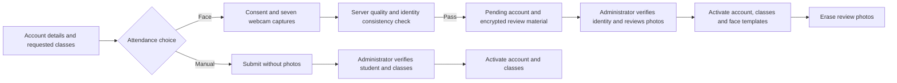
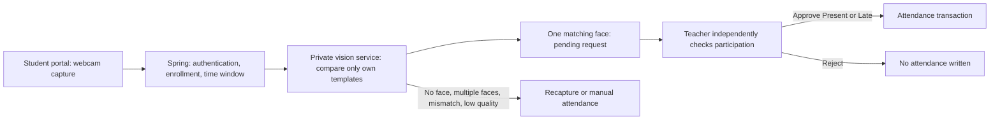

# Phase 2A: student capture with teacher approval

[한국어 가이드](phase2a-student-checkin.ko.md)

Work branch: `DoJun/phase2-student-attendance`, integrated with phase-1 commit `42efcb4` (including upstream main `3dc80b5`). No commit, push, PR, or production deployment performed by the agent.

## Integration with current main (2026-10-22)

Browser authentication uses HttpOnly session cookies and CSRF protection, including multipart registration and check-in. Existing passwordless student records still require a single-use activation proof (`emailProof`) and admin review; staff activation keeps the original email-link contract. Registration options are public, but photos and decisions retain their role checks. Session start/end values are actual UTC instants from the shared timetable; the old Auckland wall-clock-as-UTC adapter must not be used.

## Scope and flow

### Registration extension (2026-10-20)

New students choose **Manual attendance** (default, no photos) or **Face attendance**. Both create a `PENDING` account and class requests. Face attendance is an optional adult-volunteer pilot: after explicit consent, the student takes seven prompted webcam captures. The real YuNet/SFace enrollment endpoint checks image quality, one face per capture and identity consistency before creating the registration. Failure leaves no account or class requests. Poses and liveness are not automatically verified.

In **Admin → Registrations → Review**, the administrator checks the student's ID and classes against independent records, reviews all seven captures for face attendance, and explicitly confirms identity. Approval atomically activates the account, requested class memberships and, for face attendance, encrypted `cv_face_profiles` templates. These templates work with student check-in and teacher photo recognition. Account approval itself never records attendance. Teachers cannot approve registrations or retrieve registration photos.

Review photos/templates are encrypted in `cv_registration_faces`, separate from active profiles. Photos are available only to administrators for pending, unexpired registrations through an authenticated `no-store` endpoint; embeddings never reach the browser. Photos are erased on approval, rejection, a student's switch to manual attendance, or seven-day expiry (cleanup every minute). Expired photos cannot activate templates. Students can remove their photos and switch to manual attendance from the pending screen; the administrator must refresh the queue afterward. Active templates expire 30 days after the original consent and can be withdrawn using the existing consent UI. Manual registration and approval work with CV disabled.

Run the repository Flyway migration command before restarting the backend, even with CV disabled. V4 adds student check-ins and V5 adds registration review; existing V1–V3 migrations remain unchanged. Do not apply the historical standalone SQL files to an already Flyway-managed database. No existing face or attendance data is migrated. Older API clients retain the legacy registration adapter; the new UI sends explicit `attendanceMode` and uses the real CV pipeline. Older pending requests are treated as manual attendance by this review screen; legacy face files are not silently promoted into CV templates.

| API | Contract |
| --- | --- |
| GET `/api/auth/registration-options` | Public `{faceEnabled, noticeVersion}` |
| POST `/api/auth/register/student` | Existing multipart fields; registration adds `attendanceMode: MANUAL\|FACE`, `adultConfirmed`, `noticeVersion`. FACE requires consent, seven ordered metadata prompts and images; MANUAL rejects photos |
| GET `/api/admin/students/pending` | Adds `attendanceMode`, `faceReviewState`; no biometric payload |
| GET `/api/admin/students/{id}/registration-face` | Admin only: `{attendanceMode, state, expiresAt, photos}`; short-lived JPEG data URLs |
| POST `/api/admin/students/{id}/approve` | Admin only: `{identityConfirmed:true}` for new explicit-mode requests |
| POST `/api/admin/students/{id}/reject` | Existing admin action; also erases pending biometric material |
| GET `/api/auth/students/{id}/registration-attendance` | Student self only: mode and state |
| PUT `/api/auth/students/{id}/registration-attendance/manual` | Pending student self only: erase photos/templates, withdraw biometric consent, keep account pending |

Test registration with a new student ID/email: sign out → Create account → enter details and choose an active class → select attendance method → submit → see Registration submitted. Sign in as **admin** → Registrations → Review → independently verify identity → confirm → approve. Sign in again as the student or use Refresh approval status. Face-approved students can request photo attendance without repeating teacher enrollment; manual-approved students use manual attendance. This administrator approval is separate from a teacher's later attendance approval.

Students open their portal overview, choose a currently available class, consent to capture, and take one webcam photo. Spring authenticates the student, checks active class membership and the check-in window, and sends **only that student's templates** to the existing YuNet/SFace service. Exactly one detected face with a `MATCH_CANDIDATE` for that student creates a pending request. No attendance is written at this stage.

The assigned teacher opens that session's **Student check-in requests**, independently checks participation, and approves Present/Late or rejects. Approval writes through the existing attendance repository and refreshes the attendance table; rejection never writes attendance. An approved mark uses the request submission time as check-in time, and separately retains the reviewer/time for audit. Manual attendance and phase-1 group-photo review remain available.

Liveness/PAD is **not implemented**. Webcam capture is a convenience, not proof of live presence: a modified client can submit files and a camera can photograph a screen. There is no automatic attendance, continuous monitoring, online participation inference, emotion/fatigue/attention inference, or robot integration. Enrollment uses administrator-reviewed registration or the existing teacher-supervised flow. Accuracy across people, thresholds for 1:1 verification, and spoofing resistance remain unvalidated; the prior personal lighting/clothing tests do not establish population accuracy.

## Rules

The shared timetable stores actual UTC instants. Check-in queries, responses and attendance windows use those values directly; the student UI displays Auckland time. Legacy timetable data must follow the main project session-time migration before adoption, not an extra runtime conversion in check-in.

- Approved, active account; active class enrollment; valid optional consent and unexpired face templates.
- New requests: server time from 15 minutes before scheduled start (inclusive) to session end (exclusive); session must be SCHEDULED or ACTIVE. The list shows enrolled sessions overlapping the previous/next 24 hours. Client flags are advisory; the server rechecks at submission and after inference.
- At most one live pending request per student/session, serialized on the session row. A failed, rejected or expired attempt may be recaptured while the window is open. Already-recorded attendance blocks new requests.
- Review expires 30 minutes after submission. A teacher can review after class ends if still within that expiry; cancelled sessions cannot be approved. Late/Present is a teacher decision, not an automatic timing rule.
- UUID idempotency key is scoped to the authenticated student and bound to the image digest and session. A retry returns the original request; reuse for a different image/session returns 409. No automatic client retry.
- Consent withdrawal/reenrollment erases pending payloads. Approval rechecks consent revision, class membership and attendance version. Concurrent identical approvals are idempotent; conflicting decisions and manual attendance changes cannot be overwritten.
- Student responses contain only their request/status and enrolled session details. Neither students nor teachers receive embeddings or similarity scores through the check-in API.

## Database and local startup

Run the repository Flyway migration command before starting this backend. V4 adds `cv_student_checkins` and V5 adds `cv_registration_faces`; existing phase-1 data is preserved. Fresh installations also use Flyway. Do not initialize or upgrade a Flyway-managed database with `database/schema.sql` or the historical individual migration scripts.

Reuse the existing PostgreSQL, Spring, Python, Vite, service key, encryption key and model files. No new model or package dependency is required. Back up a development database before applying migrations; do not apply to production as part of this task. The normal setup remains in [the phase-1 guide](phase1-photo-attendance.md).

## API contracts

All routes require a bearer token and return `Cache-Control: no-store`.

| Method and route | Authorized caller | Contract |
| --- | --- | --- |
| GET `/api/vision/students/{studentId}/check-ins` | Student self only | `{enabled, ready, sessions:[{sessionId, course, startTime, endTime, canSubmit, attendanceStatus, request}]}` |
| POST `/api/vision/students/{studentId}/sessions/{sessionId}/check-ins` | Student self only | Multipart `image`, `captureConsentConfirmed=true`; UUID `Idempotency-Key`; returns request |
| GET `/api/vision/sessions/{sessionId}/check-ins` | Teacher with session access | Request list for that session |
| POST `/api/vision/check-ins/{id}/decision` | Teacher with session access | JSON `{teacherConfirmed:true, status:"PRESENT"\|"LATE"\|"REJECTED"}`; returns updated request |

Request fields: `id`, `studentId`, `studentName`, `state`, `createdAt`, `expiresAt`, `reviewedAt`. States: PENDING, PRESENT, LATE, REJECTED, EXPIRED. Relevant errors: 401 unauthenticated; 403 wrong identity/class/scope; 409 pending/recorded/stale/outside window; 410 expired review; 413 image limit; 422 failed single-face verification; 429 recognizer busy. A 422 does not create a request or mark absence. Existing 7 MiB server image limit and vision quality rules apply.

## Retention and security

No raw photo is persisted. Failed client captures remain in memory for explicit retry for up to five minutes, or until discard, replacement, consent loss refresh or unmount. Successful captures are released immediately. The result and consent/attendance snapshot are AES-GCM encrypted with request-specific AAD; they are erased on decision, consent withdrawal, reenrollment, or expiry cleanup. Pending results expire after 30 minutes; the scheduled sweep runs each minute. Request metadata (including student/session IDs, digest and reviewer) is retained up to 90 days, with a one-minute cleanup interval. No images, templates or credentials should appear in logs or Git.

## Acceptance and evidence

- The student cannot request for another identity or a class they are not actively enrolled in.
- No-face, multi-face, unknown, uncertain and low-quality outputs cannot create a request; only own templates are sent to inference.
- A valid request leaves attendance untouched until explicit scoped teacher approval; rejection leaves it untouched.
- Repeat requests/approvals cannot duplicate attendance. Consent withdrawal, enrollment changes, expiry and concurrent manual corrections prevent stale approvals.
- Student and teacher flows work at desktop and mobile widths with camera release, status refresh, retry and manual fallback.

Validation includes Java integration/API tests with mocked inference and isolated databases, the existing frontend model suite, TypeScript/Vite build, and actual UI components under synthetic-camera/mocked-API browser checks. Evidence is summarized in [the work checkpoint](phase2a-work-in-progress.md). These tests do not establish face matching accuracy or real-phone compatibility, and they are not a full live-model browser-to-database test. Keep teacher approval until those separate pilot evaluations and deployment permissions are resolved.
