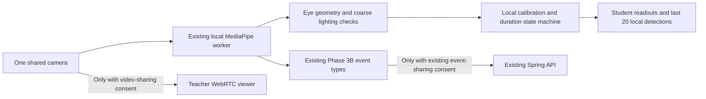

# Phase 3D — local eye and head observations

This experimental adult-volunteer feature measures **sustained bilateral eye closure** and **sustained head lowering relative to a calibrated forward pose**. It does not classify sleep, fatigue, emotion, attention, engagement or attendance. There is no combined score or teacher alert for these new measurements.

## Student test flow

1. Use the existing local start command and sign in as an approved student. No new environment variable, database migration, package or model download is needed if the Phase 3A model assets are already installed.
2. Overview → **Open classroom camera**. Confirm adult participation/local analysis consent, and **Start camera**. Select an open class before starting only if also testing the existing sharing features.
3. In **Local eye and head observations**, enable **Enable local eye and head observations**. It defaults to off and does not acquire another camera.
4. Select **Calibrate open eyes and head**. Face forward with both eyes naturally open and hold still for two continuous seconds. Calibration collects at least eight usable samples and restarts its interval after a blink, large movement or uncertain input. This reference is separate from the earlier **Set forward reference** control.
5. Briefly blink: no sustained history entry should appear. Close both eyes for more than two seconds: the eye readout should count continuous observed time and add one entry. Reopen to reset the current duration. A wink/asymmetric measurement should show **Not measurable**.
6. Return to the calibrated forward position, then lower the head slightly. At least 15° of downward pitch for three seconds creates a head entry. Looking up must not create a lowered-head entry. Large pose angles are not measurable. Both readouts currently depend on usable eye geometry and lighting; failed eye measurements can also interrupt head measurement, even if a head transform is available.
7. Try poor lighting, covering the face, turning far sideways and moving outside the frame. Recognized quality failures reset durations; **Not measurable** never counts toward a sustained event. The quality checks are limited and may miss an obstruction or model error.
8. Switch windows/tabs: capture is retained, but a hidden tab or missing/stale samples must not bridge the measurement duration. Return and observe that a new continuous interval is required.
9. Enable existing event sharing and live video if desired. The teacher can still receive the original Phase 3B events and view the video; **new eye/head results are not sent**. A teacher seeing the video can of course see the person's face/posture.
10. Disable this local test: its reference/history clear; existing analysis and sharing continue. Stop the camera, revoke the camera consent or close the panel: all camera functions stop, and this test restarts off. Recalibration also clears this local history. Clear history alone keeps calibration.

## Data path and implementation

- `frontend/public/webcam-local-signals.js`: measures two eyelid separations per eye divided by horizontal eye width, using pixel coordinates to avoid aspect-ratio distortion. Returns only two aperture ratios and a quality reason, not the face mesh.
- `frontend/public/webcam-worker.js`: reuses the installed Face Landmarker, with blendshapes still disabled. A 32×32 face crop is used transiently for mean luminance/contrast; no image is retained or transmitted. Unsupported quality measurement makes this experiment unavailable without breaking the existing worker/video flow.
- `frontend/src/features/webcam-events/eyeHeadModel.ts`: pure, bounded calibration/duration state machine. Its event types are separate from `Observation` and have no API/storage dependency.
- `LocalEyeHeadPanel.tsx`: opt-in, calibration, independent eye/head readouts, memory-only history and lifecycle reset. Parent `WebcamEventsPanel.tsx` passes the same existing camera samples. Original observation payloads remain unchanged.
- `frontend/tests/localEyeHead.test.cjs`: timing, quality, directional pose, calibration, history bounds and worker-output contract regressions.

The browser keeps at most 20 detections. No localStorage, database, recording, teacher summary, backend endpoint or migration is added. Stopping or disabling this experiment clears its memory state. Processing is local, but this does not claim to make independently enabled live video private from its recipient.

## Experimental settings and limits

| Setting | Initial local value |
| --- | --- |
| Calibration | ≥2 s and ≥8 samples; naturally open aperture 0.18–0.50; pose variation ≤5° and aperture variation ≤20% from first sample |
| Eye closed candidate | Both ratios ≤50% of each calibrated open-eye ratio |
| Eye open | Both ratios ≥75% of each calibrated ratio; intermediate/asymmetric states are unmeasurable |
| Sustained eye closure | ≥2 s continuously sampled; one entry per episode |
| Sustained lowered head | Downward pitch delta ≥15° for ≥3 s; upward pitch is excluded |
| Continuity | Gaps >750 ms reset both timers; hidden tab/unavailable frames also reset |
| Eye geometry | Each eye at least 16 pixels wide, finite in-frame landmarks, bounded ratios |
| Coarse image gate | Face mean luminance 25–240 and standard deviation ≥8 (0–255 scale) |
| Pose limits | Overall yaw ≤35°, roll ≤25°, pitch ≤60°; tighter relative eye-angle limits |

These numbers are engineering starting points, not medical or education-validated thresholds. Camera optics, eyelid anatomy, glasses, reflections, skin illumination and partial covering can change results. Landmark estimates can remain plausible under occlusion; these gates **cannot reliably detect all occlusions**. No accuracy percentage is claimed. Do not treat an inability to calibrate as evidence of closed eyes. Calibration is not identity verification; recalibrate after changing the participant/camera/posture.

The existing pipeline samples at up to five results per second. Durations describe continuity across observed samples, not proof that the physical state remained unchanged between frames. Short blinks may be missed; this is not a blink-rate measurement system.

Coordinate/landmark references: [MediaPipe face geometry](https://github.com/google-ai-edge/mediapipe/blob/master/docs/solutions/face_mesh.md), [official eye-contour connections](https://github.com/google-ai-edge/mediapipe/blob/master/mediapipe/python/solutions/face_mesh_connections.py). Positive pitch in the existing Y-up canonical transform lowers the nose. This interpretation has synthetic-transform coverage; physical-camera direction and thresholds still need participant validation.

## Acceptance and next validation

### Scope closure and user-reported physical test

Phase 3D is closed at its current **local experiment** scope. Further detector changes are deferred; this is not production accuracy approval. The user reported that eye closure worked without glasses, but wearing glasses caused repeated switches between **Not measurable** and **Not observed**. Reflections were suspected, not confirmed as the cause. Lowered-head detection also worked, including during note-taking. That is a posture observation, not evidence of sleep.

These are qualitative results from one tester, without annotated intervals or accuracy statistics. Glasses performance, broader participant coverage and reliable measurement availability remain unresolved. Do not require participants to remove glasses to use the application. No sleep/attention classifier, combined score, attendance consequence or teacher alert is introduced. Existing Phase 3B event sharing and live video remain separate; the new Phase 3D values stay local.

Future work may investigate glasses robustness, independently gating head and eye measurements, and clearer availability feedback. Any such work needs a separate scope and validation; it is not part of this closure. The immediate next work is Phase 2 integration and a separate Phase 2/3 UI cleanup.

Automated acceptance requires: short blinks/winks/upward head motion produce no corresponding sustained detection; unavailable input and gaps reset time; continued observations emit once; history is bounded; recalibration/stop clears state; no new local result enters API payloads; one camera supports local analysis and live video concurrently.

Before expanding beyond this local experiment, record consenting adult trials across glasses/no glasses, lighting, skin illumination and camera angles. Include open eyes, brief blinks, deliberate sustained closure, looking up, reading/typing with a lowered head, occlusion and multiple faces. Compare **observable eye/head states** with manually annotated intervals; measure false detections per minute, missed intervals, unmeasurable time, calibration success and timing error. Report raw counts and sample size; do not relabel these observations as sleep/fatigue/attention. Any future inference of those states requires separate deployment-specific legal and validation review under the project's original requirements.

### Verification on 2026-10-26

- Production build/typecheck and **388 frontend tests passed**, including 12 new local observation/worker tests. No backend code or schema changed; backend tests were not rerun for this frontend-only change.
- Real Chrome loaded the installed MediaPipe worker and new helper with a synthetic camera. Missing-face input remained unavailable. Controlled landmark/pose samples then verified the positive eye/head cases, calibration, blink/wink exclusion, lighting failures, upward-vs-downward pitch and hidden-tab reset. These controlled samples validate processing/UI behavior, **not physical-face accuracy**.
- Real student-to-teacher WebRTC decoded video while the same camera fed analysis. Existing `HEAD_TILT` events continued to reach the API; captured request bodies contained none of the new `EYES_CLOSED`, `HEAD_LOWERED` or `localEyes` data. Independent feature disabling preserved both sharing channels; camera stop/restart cleared this experiment and required re-enabling/calibration.
- Desktop and 390px mobile layouts had no horizontal overflow or page errors. Temporary QA accounts/class were removed; no attendance records were created. Physical camera/face accuracy, glasses/lighting diversity, separate devices/networks and class-scale load remain unverified.
