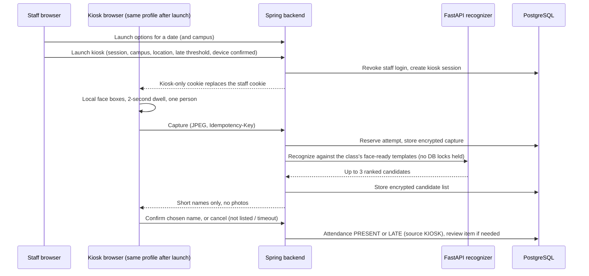

# Phase 4A: entrance attendance kiosk

A teacher or admin turns one browser at the classroom door into a face check-in kiosk for one class
session. A student stands in front of the camera. The Phase 1 CPU recognizer proposes at most three
names from that class, and the student chooses their own name. Only that confirmation records
attendance, with source `KIOSK`. Recognition alone never records attendance.

When a student chooses a name other than the top match, or a student who is not enrolled tries to
confirm, the attempt goes to an admin review queue with a photo kept for 30 days.

**Policy difference from Phases 1–2.** In photo attendance and student check-in, a teacher confirms
every AI-assisted attendance write. The kiosk is a separate policy that a teacher starts explicitly:
a teacher with access to the class authorises one kiosk for one session, and the student confirms
each record. Admin review checks the risky cases afterwards. Webcam observations (Phases 3A–3D) stay
separate and never feed kiosk attendance.

**This is a pilot policy.** For now, a kiosk check-in is final as soon as the student confirms the
recognised name; no teacher confirms it afterwards. After user testing with a large amount of data,
the results will decide whether kiosk records stay final or a teacher must confirm them again (see
[Open decisions](#open-decisions)).

## Scope and limits

- **Recognizer.** The kiosk uses the Phase 1 recognizer and its settings. See
  [Phase 1](phase1-photo-attendance.md) for `CV_SERVICE_URL`, `CV_SERVICE_KEY` and
  `CV_ENCRYPTION_KEY`. If recognition is disabled, kiosks cannot start.
- **One kiosk, one session.** The session must have an assigned class with at most 30 active,
  approved students. At least one of them must be face-ready: active face consent and an enrolled
  template ([Phase 2A](phase2a-student-checkin.md)).
- **Where candidates come from.** Candidates come only from that class's face-ready students.
  - If the best similarity is below `CV_MATCH_THRESHOLD` (default `0.5`, uncalibrated pilot value),
    no names are shown.
  - Otherwise the three highest scores are shown, even when the second and third are weak. Expect
    look-alike names, and note that three names need three face-ready students in the class.
- **Self-confirmation.** The kiosk does not check that the person tapping a name is the person who
  was recognised. Choosing the top match never creates a review item, so a student who chooses a
  top match that belongs to someone else is not flagged.
- **No liveness check.** There is no presentation-attack detection, so a printed photo may be
  recognised.
- **Not an absence or behaviour signal.** No face, "I'm not listed", a timeout or a cancelled scan is
  not an absence. Kiosk captures are not evidence of attention or behaviour.
- **Not deployment approval.** Applicable law, institutional policy, valid consent, model
  suitability, security and backup retention must be reviewed before any real deployment.

## Flow



## Staff: starting and ending a kiosk

Teachers and admins open **Entrance Kiosk** from the console menu.

1. Choose a campus and a session. A session that cannot use a kiosk shows the reason:

   | Reason | Meaning |
   | --- | --- |
   | `CANCELLED` | The session was cancelled |
   | `WINDOW_CLOSED` | The session has ended, is completed, or is on an earlier day |
   | `TOO_EARLY` | More than 2 hours before the class starts |
   | `NO_CLASS` | No class is assigned to the session |
   | `ROSTER_TOO_LARGE` | More than 30 eligible students |
   | `RECOGNITION_DISABLED` | The recognizer is not configured |
   | `NO_FACE_READY_STUDENTS` | No student in the class has active consent and an enrolled template |

2. Enter a location label of 2 to 80 characters, for example "Main entrance".
3. Optionally set **Mark Late after** 0 to 60 minutes from the class start. Captures taken after that
   time record `LATE`. Without it, every check-in is `PRESENT`.
4. Tick the device confirmation and choose **Start kiosk on this device**. The kiosk campus must match
   the classroom's campus.

Access follows the shared session rule: admins, teachers of the session's class, and the session
teacher of a session without a class.

**Starting a kiosk signs this browser out.** In one transaction the staff login is revoked and a
kiosk-only cookie (host-only, `HttpOnly`, `SameSite=Strict`) replaces it, so every tab in that
browser profile becomes the kiosk. Browser sessions are one cookie per browser, so a staff session
cannot share a profile with the kiosk. Leaving a staff session on an unattended device at the door
would also expose staff pages. To keep working as staff on the same computer, run the kiosk in
another browser profile or a private window, or use a separate device such as a tablet.

**Ending a kiosk.** A kiosk ends in any of these ways:

| End reason | When |
| --- | --- |
| `EXPIRED` | Class end + 10 minutes, or 12 hours after launch, whichever is earlier |
| `DEVICE_EXIT` | **Staff** → **Exit kiosk** on the device |
| `STAFF_ENDED` | A staff member ends it from **Kiosk activity** on the launch page |
| `ACCESS_LOST` | The staff member who launched it loses access to the class |

Ending a kiosk revokes its credential at once. Exiting on the device has no password, because it only
ends the kiosk and signs the browser out; staff must sign in again to use that browser. The kiosk
cookie cannot open staff pages.

**Kiosk activity** on the launch page lists the selected session's kiosks (location, who started it,
start, expiry, end reason, confirmed count) and a paginated check-in log.

## Student flow on the device

- **Check-in window.** Check-in opens 15 minutes before class and closes at the class end, for
  scheduled or active sessions only. Before it opens the kiosk waits; afterwards it shows
  "Check-in has closed".
- **Taking a scan.**
  - A local face detector (the Phase 3A MediaPipe worker) only decides when to capture; it uploads
    nothing itself.
  - The kiosk captures once after one face has stayed in view for 2 seconds. The face must be at least
    16% of the frame width. **Check in now** captures straight away.
  - After a result, the next scan needs the camera to see nobody for 1 second, or 6 seconds to pass.
  - The upload is one unmirrored JPEG, at most 960 px on the long edge and 2 MB.
- **Scan results.**

  | Result | Kiosk shows |
  | --- | --- |
  | `NO_FACE`, `MULTIPLE_FACES`, `LOW_QUALITY` | A retry notice with guidance |
  | `NO_CANDIDATE` | Retry once; a second miss in a row asks the student to see the teacher |
  | Candidates | **Is this you?** with up to three names |

- **How names are shown.** Names are short: first name plus last initial. If two short names are the
  same, full names are used. If those also match, the last three digits of the student number are
  added. No photos are shown.
- **Choosing.** The student taps a name and **Confirm attendance**, or **I'm not listed**. The choice
  closes after 30 seconds on the device, and the server expires an unanswered scan after 120 seconds.
- **Confirm results.**

  | Result | Meaning |
  | --- | --- |
  | `CONFIRMED` | Attendance recorded as `PRESENT` or `LATE` |
  | `ALREADY_RECORDED` | An existing `PRESENT`/`LATE` mark is kept unchanged |
  | `ATTENDANCE_LOCKED` | The teacher already marked `ABSENT`; the kiosk does not overwrite it |
  | `NOT_ENROLLED` | No active, approved enrollment; a review item is created |
  | `CANDIDATES_STALE` | Consent or enrollment changed during the scan; scan again |
  | `KIOSK_SESSION_CLOSED`, `ATTEMPT_EXPIRED` | Closed or timed out; nothing is written |

- **What a confirmation writes.** A confirmed check-in sets status `PRESENT` or `LATE`, source
  `KIOSK`, check-in time = capture time, and clears any absence reason. It also adds a
  `KIOSK_SELF_CONFIRMED` entry to the attendance review history.

## Admin review

Admins see **Kiosk Reviews** with a badge for open items. There are two kinds:

- `CANDIDATE_SELECTION_MISMATCH`: the student chose a name other than the recognizer's original top
  match (rank 2 or 3), and attendance was confirmed or already recorded.
- `NOT_ENROLLED_ATTEMPT`: the chosen student had no active, approved enrollment.

Each item shows the chosen student, the top match, class, campus, location, times, the result and the
capture photo until it expires. Resolve it as **Verified correct**, **Attendance corrected** or
**No action**, with an optional note of up to 500 characters. Resolving does not change attendance;
correct the session register first. Resolving again with a different outcome returns
`409 REVIEW_ALREADY_RESOLVED`.

## Data, privacy and retention

- **Privacy notice on the device.**
  - The kiosk screen always shows the minimum notice required by rule 3 of the New Zealand
    Biometric Processing Privacy Code 2025: that face recognition is used, what for, the
    non-camera alternative, and where to read more.
  - **Privacy** opens the full notice: who runs the kiosk and the trial, what is collected and why,
    who can see it, how long it is kept, and the right to see or correct information.
  - Automatic capture pauses while the notice is open, and the notice closes itself after
    60 seconds.
  - On short portrait screens (phones) the summary shrinks to its heading while a name is being
    chosen, so the names and Confirm fit. Tablets, desktops and the result view always show the
    full summary.
  - The wording and the operator details are in `features/entrance-kiosk/privacyNotice.ts`.
  - The notice is ready for internal testing only. It is not complete for testing with
    participants until the steps in [Before participant testing](#before-participant-testing) are done.
- **Capture image.** Encrypted with a key bound to its attempt while the student chooses, and erased
  as soon as the attempt finishes.
- **Evidence photos.** Kept for 30 days, encrypted, only for `CONFIRMED`, `BLOCKED_NOT_ENROLLED`, and
  `ALREADY_RECORDED` after choosing a name other than the original top match (`selectedRank` > 1).
  Only admins can fetch them; an expired photo returns `410 EVIDENCE_EXPIRED`.
  - Rank is the recognizer's original rank, not the position on screen. If the top match is deleted
    during recognition, the original second match is shown first and still counts as rank 2.
- **Candidate list.** Encrypted while the attempt is open, erased when it finishes.
- **What responses and logs contain.** Kiosk responses never include photos or face templates, and
  templates go only to the recognizer. Logged kiosk responses, captures and evidence are redacted.
- **What an attempt keeps.** State, candidate count, top candidate ID, chosen student, rank and
  display name, attendance status, quality reasons, campus, location and times.
- **Purge.** While the backend runs, a purge every 10 minutes expires unanswered scans, deletes
  evidence older than 30 days and ends expired kiosks. Backups follow their own retention.
- **Deleting students.**
  - Deleting the chosen student deletes their attempts, evidence and review items.
  - Deleting a top-match student keeps the attempt and its evidence; only the top-match link is
    cleared (V10).

## Backend contracts

Errors use `application/problem+json` with a `code` field. Every `429` has `Retry-After: 2`.

| Route | Who | Request → response |
| --- | --- | --- |
| GET `/api/kiosk/launch-options?date=&campusId=` | Staff | Campuses, the caller's sessions for the date with `launchable`, `blockedReason`, `rosterSize`, `faceReadyCount`, and up to 10 recent location labels for the campus |
| POST `/api/kiosk/sessions` | Staff | `{sessionId, campusId, locationLabel, lateAfterMinutes, deviceConfirmed: true}` → 201 and the kiosk cookie; the staff login is revoked |
| GET `/api/kiosk/sessions?sessionId=` | Staff | Kiosks for the session with confirmed counts |
| POST `/api/kiosk/sessions/{id}/end` | Staff | 204; ends the kiosk (`STAFF_ENDED`) |
| GET `/api/kiosk/attempts?sessionId=&page=&size=` | Staff | Check-in log, newest first, size 1–100 |
| GET `/api/kiosk/device` | Kiosk | Class, campus, location, window state, server time, `captureCooldownMs` 2000, `attemptTtlSeconds` 120, `maxImageBytes` |
| POST `/api/kiosk/device/captures` | Kiosk | Multipart `image` (JPEG or PNG by signature, ≤2 MB) and an `Idempotency-Key` UUID header → 201 new or 200 replay |
| POST `/api/kiosk/device/attempts/{id}/confirm` | Kiosk | `{candidateId}` → `{attemptId, result, attendanceStatus, displayName, processedAt, replayed}` |
| POST `/api/kiosk/device/attempts/{id}/cancel` | Kiosk | `{reason: "NOT_LISTED" or "TIMEOUT"}` → 204 |
| GET `/api/admin/kiosk-reviews?state=OPEN\|RESOLVED\|ALL&page=&size=` | Admin | Review items |
| GET `/api/admin/kiosk-reviews/summary` | Admin | `{open}` |
| GET `/api/admin/kiosk-reviews/{id}/evidence` | Admin | Decrypted photo, or 410 |
| POST `/api/admin/kiosk-reviews/{id}/resolve` | Admin | `{resolution, note}` |

**Capture.**

- **Response.** `attemptId`, `outcome`, `state`, `qualityReasons`, `candidates`, `capturedAt` and
  `expiresAt`. Each candidate is `{candidateId, rank, displayName, photo: null}`.
- **Candidate IDs.** `candidateId` is `"c"` plus the recognizer's original rank. If a ranked student
  was deleted during recognition, the IDs can have gaps, for example `c2` and `c3` without `c1`.
  Clients must treat IDs as opaque.
- **Same key again.**
  - The image must be the same, otherwise `409 IDEMPOTENCY_KEY_REUSED`.
  - `NO_FACE`, `MULTIPLE_FACES`, `LOW_QUALITY`, `NO_CANDIDATE` and an open attempt replay their
    original body.
  - A finished attempt returns an error: `410 ATTEMPT_EXPIRED` (expired), `409 KIOSK_SESSION_CLOSED`
    (session closed) or `409 ATTEMPT_FINALIZED` (any other end state).
  - An attempt still being processed returns `429 RECOGNIZER_BUSY`.
- **Other errors.**

  | Code | Status | When |
  | --- | --- | --- |
  | `KIOSK_WINDOW_NOT_OPEN` | 409 | The check-in window has not opened |
  | `NO_FACE_READY_STUDENTS` | 409 | No face-ready students in the class |
  | `CAPTURE_RATE_LIMITED` | 429 | Less than 2 seconds since the last capture |
  | `RECOGNIZER_BUSY` | 429 | The recognizer or this device is busy |
  | `RECOGNITION_UNAVAILABLE` | 503 | The recognizer is not available |
  | `RECOGNIZER_INVALID_RESPONSE` | 502 | The recognizer replied with an invalid response |
  | `INVALID_IMAGE` | 400 | Not a JPEG or PNG |
  | `IMAGE_TOO_LARGE` | 413 | Over 2 MB |

- **Superseding.** A new capture on the same device ends that device's previous open attempt as
  `SUPERSEDED`.

**Confirm.**

- **Replays.** Sending the same candidate again returns the original result with `replayed: true`. A
  different candidate on a finished attempt returns `409 ATTEMPT_FINALIZED`.
- **Errors.** `ATTEMPT_EXPIRED` (410), `KIOSK_SESSION_CLOSED` (409), `NOT_ENROLLED` (403),
  `CANDIDATES_STALE` (409), `ATTENDANCE_LOCKED` (409) and `INVALID_CANDIDATE` (400).

**Database.**

- **V9.**
  - Adds the `KIOSK` login role and attendance source.
  - Adds the tables `kiosk_sessions`, `kiosk_attempts`, `kiosk_evidence` and `kiosk_review_items`.
- **V10.**
  - Clears `top_student_id` instead of deleting the attempt when that student is deleted.
  - Adds campus indexes for the retained-history check before a campus is deleted.
- **Applying them.** Flyway applies both on backend start. Do not run SQL by hand.

## Local test

1. Start the stack from the repository root:

   ```powershell
   powershell -ExecutionPolicy Bypass -File .\data\local-dev\start.ps1
   powershell -ExecutionPolicy Bypass -File .\data\local-dev\stop.ps1
   ```

   Open `http://127.0.0.1:5173`. Restart the backend after a backend change.
2. Prepare a session today with an assigned class and at most 30 students. Give at least one student
   active face consent and an enrolled template. For three candidates, prepare three face-ready
   students.
3. Use a separate browser profile, a private window or another device for the kiosk, because starting
   it signs that browser out.
4. Check these cases:
   - One person: a scan, the correct name, and `PRESENT`. Repeat after the late threshold for `LATE`.
   - **I'm not listed**, and letting the choice time out: nothing is recorded.
   - Two people in view: "One person at a time".
   - A person with no face enrollment, twice in a row: the kiosk asks them to see the teacher.
   - Choosing the second name: a review item appears for admins.
   - A student the teacher already marked absent: attendance is not overwritten.
   - Ending the kiosk from **Kiosk activity** in another browser, and **Exit kiosk** on the device.
5. As an admin, open **Kiosk Reviews**, check the photo and resolve the item.

## Verification

Checked on 2026-11-08 on the integration branch.

| Check | Result |
| --- | --- |
| Backend `mvn -q test` | 720 tests: 714 passed, 6 skipped. The 5 conditional PostgreSQL tests need `schemaCheck.url`; the real-recognizer test needs `CV_TEST_SERVICE_URL`. |
| Frontend `npm test` | 422 passed, including the kiosk flow-model tests |
| Frontend `npm run build` | Passed |
| Read-only check on local PostgreSQL 16 | Launch options, recent locations, rosters for four sessions, student face status, kiosk lists and check-in logs all returned 200, and face-ready counts agreed across endpoints |

**Not yet covered.**

- On real PostgreSQL: a teacher being refused another teacher's session, and the profile check at
  confirm time.
- Multi-person tests with a real camera.
- Phone or tablet hardware.

## Known limitations

- **A crash during recognition blocks the device briefly.** If the backend stops while a capture is
  being recognised, that device's next captures get `RECOGNIZER_BUSY` for up to 2 minutes, until the
  reserved attempt expires.
- **One staff session per browser profile.** Starting a kiosk signs that profile out.
- **Weak extra candidates.** The match threshold is uncalibrated, and the second and third
  candidates can be weak matches.
- **No liveness check.**
- **The preview hides part of the frame.** The preview fills its box (`object-fit: cover`), but the
  upload is the full camera frame. A person outside the visible preview can still cause
  `MULTIPLE_FACES` or be recognised.
- **Purge needs a running backend.** Retention purges run only while the backend is running.

## Before participant testing

The kiosk is ready for internal testing only. Do these before anyone outside the team uses it.

- [ ] Set the real operator details in `KIOSK_PRIVACY_SETTINGS`
  (`frontend/src/features/entrance-kiosk/privacyNotice.ts`). The operator is Creative Imagination Lab.
  - `agencyAddress`: the real address. It replaces the "TEST ONLY" placeholder.
  - `contact`: where people ask to see or correct their information, for example an email
    address. Until it is set, the notice tells people to ask their teacher how to contact the
    operator.
  - `trialPeriod`: the real trial dates, for example "from 2 March to 27 March 2027". It replaces
    the "during internal testing only" placeholder.
  - `infoUrl` (optional): a page that repeats the full notice. Without it, the notice points to
    the Privacy dialog.
- [ ] Change the test "privacy notice shows the marked placeholder operator details" in
  `frontend/tests/entranceKiosk.test.cjs` to the real values, then run `npm test`.
- [ ] Print the on-screen summary as a sign and put it at eye level next to the kiosk. The kiosk
  takes a photo after two seconds, so someone can be photographed before they read the screen.
- [ ] Run a short check with at least two people on the build that will be used (see
  [Local test](#local-test)).

## Open decisions

- **Teacher confirmation of kiosk records.** The pilot keeps kiosk check-ins final once the student
  confirms. After large-scale user testing, decide whether that stays, or whether a teacher must
  confirm kiosk records again before they count. Useful evidence from the test: how often the top
  match was wrong, how often students chose a name other than the top match, and how often admins resolved
  review items as **Attendance corrected**.
- **Preview and recognition range.** Crop the upload to what the preview shows, or show the whole
  camera frame in the preview.
- **Evidence when the top match is deleted.** Today the attempt and its photo are kept until the
  30-day expiry, and the top-match link is cleared. The recommendation is to keep this behaviour;
  it needs confirmation.
